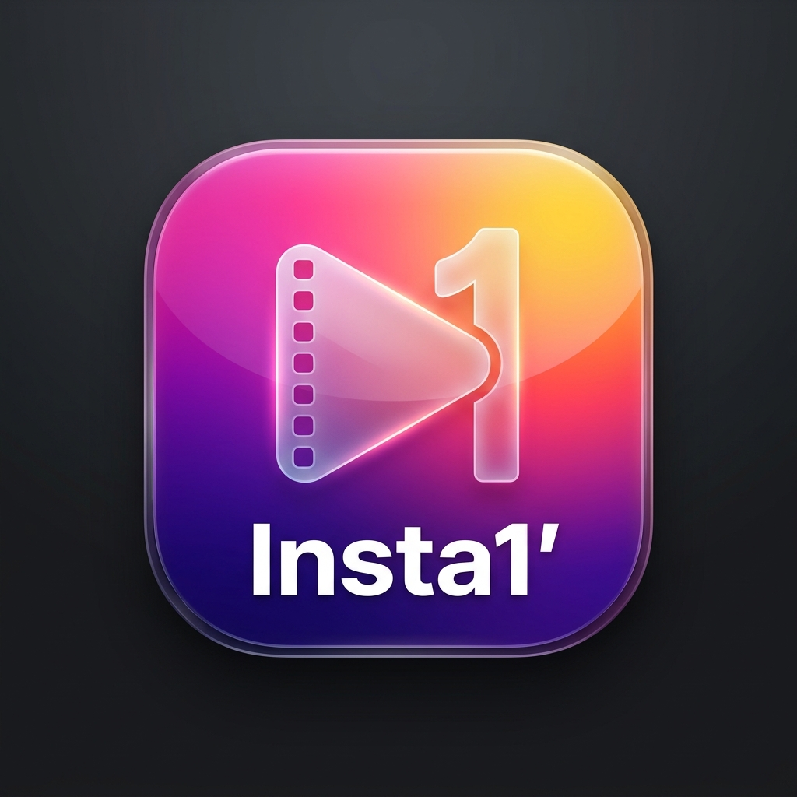

<div align="center">
  
  <h1>Insta1'</h1>
  <p><strong>Otomatik 1 Dakikalık Video Bölücü & Sıralı Galeri Aktarıcı (Android)</strong></p>

  <p>
    
    
    
    
    
  </p>
</div>

---

## 📌 Genel Bakış

**Insta1'**, kullanıcıların galerilerinden seçtikleri uzunluğu ne olursa olsun herhangi bir videoyu (ister 3 dakika, ister 1 saat) tam **1'er dakikalık (60 saniye)** sıralı parçalara bölen ve tüm parçaları **sıfır kalite kaybı** ile cihazın galerisine (`Movies/Insta1` albümüne) otomatik olarak sırasıyla aktaran modern bir Android uygulamasıdır.

Instagram Reels, Hikayeler, WhatsApp Durum ve TikTok paylaşımları için uzun videoları tek tek kırpmakla uğraşma derdine son verir!

---

## ✨ Temel Özellikler

- ⚡ **Ultra Hızlı Donanım Hızlandırmalı Kesim:**
  - Android yerel `MediaExtractor` ve `MediaMuxer` donanım kanallarını kullanır.
  - Ağır ve yavaş yeniden kodlama (re-encoding/render) yapmaz; video paketlerini doğrudan remux eder.
  - 30 dakikalık bir videoyu bile birkaç saniye içinde 1080p/4K kalitesini %100 koruyarak dilimler.
- 📱 **Otomatik Sıralı Galeri Kaydı (`MediaStore`):**
  - Kesilen her video parçası (`insta1_video_part001.mp4`, `part002.mp4`...) cihaz galerisine sırasıyla kaydedilir.
  - `MediaScannerConnection` sayesinde telefon yeniden başlatılmadan anında Galeri ve Google Fotoğraflar'da görünür.
- 🎨 **Instagram Temalı Modern Jetpack Compose UI:**
  - Canlı neon mor/pembe/turuncu Instagram degrade teması.
  - Video seçici (Picker) & video kapak önizlemesi (süre, çözünürlük, parça sayısı).
  - Canlı yüzde (%) ilerleme çubuğu ve parça durum göstergesi.
  - Kesilen videoların sıralı listesi, doğrudan uygulamadan tek tıkla galeride açma ve WhatsApp/Instagram'da paylaşma butonları.
- ⏱️ **Esnek Segment Süreleri:**
  - Varsayılan: **60 Saniye (1 Dakika)**
  - Hızlı modlar: **30 Saniye** (WhatsApp Durum) ve **15 Saniye** (Klasik Hikaye)

---

## 🛠️ Mimari ve Teknolojiler

- **Dil:** Kotlin
- **UI Framework:** Jetpack Compose (Material 3)
- **Asenkron Motor:** Kotlin Coroutines (`Dispatchers.IO`)
- **Medya Motoru:** Android Framework `MediaExtractor` & `MediaMuxer`
- **Depolama & İndeksleme:** Android `MediaStore.Video.Media` & `MediaScannerConnection`
- **Tasarım:** Instagram Gradient Stili & Modern Glassmorphism

---

## 📥 Kurulum

### Hazır APK İle Yükleme
Uygulamayı derlenmiş `.apk` dosyasından doğrudan cihazınıza yükleyebilirsiniz:
1. `insta1.apk` dosyasını telefonunuza indirin.
2. Dosyaya dokunarak yüklemeyi tamamlayın (Gerekirse bilinmeyen kaynaklara izin verin).

### Kaynak Koddan Derleme
Projeyi Android Studio veya terminal üzerinden derleyebilirsiniz:

```bash
git clone https://github.com/Emre-edis/insta1.git
cd insta1
./gradlew assembleDebug
```

Derlenen APK `app/build/outputs/apk/debug/app-debug.apk` konumunda oluşturulur.

---

## 📄 Lisans

Bu proje [MIT Lisansı](LICENSE) kapsamında açık kaynak olarak sunulmuştur.
