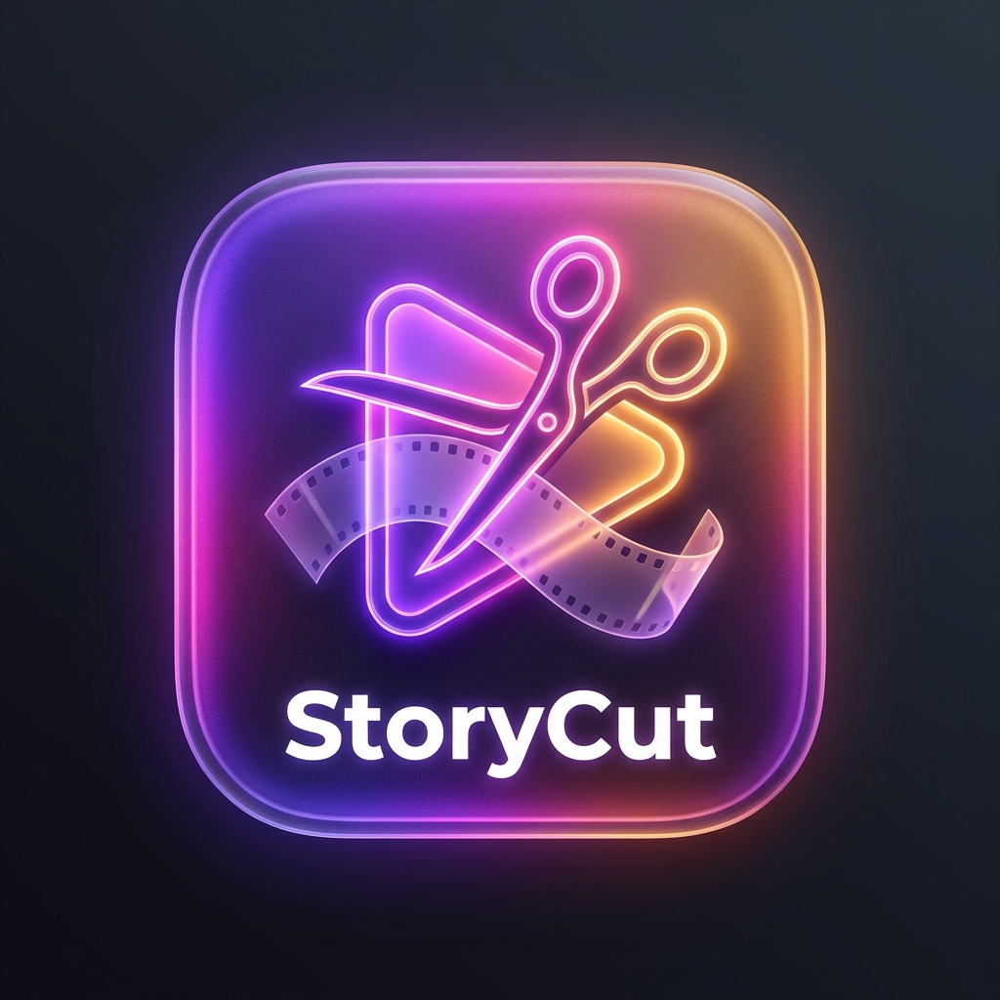

  
  <h1>StoryCut</h1>
  
<strong>Smart 1-Minute Video Splitter & Gallery Exporter for Stories & Reels (Android)</strong>

  

    
    
    
    
    
  

---

## 📌 Overview

**StoryCut** is a modern, high-performance Android utility that splits videos of any duration into sequential **1-minute (60-second)** segments and saves them automatically into your device's Gallery (`Movies/StoryCut`).

Built for content creators sharing on **Instagram Stories, Reels, WhatsApp Status, and TikTok**, it eliminates the hassle of manually trimming long videos.

---

## 💎 Freemium & PRO Features ($0.50 One-Time)

| Feature | Free Version | 👑 StoryCut PRO ($0.50) |
| :--- | :---: | :---: |
| **Video Slicing** | 1 Min / 30s / 15s | 1 Min / 30s / 15s |
| **Watermark** | Yes ("StoryCut") | 🚫 **Clean (No Watermark)** |
| **Remuxing Speed** | Standard | ⚡ **Ultra-Fast Lossless Remuxing** |
| **Advertisements** | Mini Banner Ad | 🚫 **100% Ad-Free** |
| **Billing Type** | Free | Single One-Time Purchase via Google Play |

---

## ✨ Core Highlights

- ⚡ **Lightning Fast & Zero Quality Degradation:** Hardware-accelerated processing via Android `MediaExtractor` & `MediaMuxer`.
- 📱 **Automatic Gallery Indexing:** Segments are automatically added sequentially into `Movies/StoryCut` with instant `MediaScannerConnection` updates.
- 💳 **Secure In-App Billing:** Native Google Play Billing 7.0 with encrypted local caching and signature verification.
- 🛡️ **Privacy & Security First:** All video processing is executed locally on-device. Videos are never uploaded to any cloud server.
- 🎨 **Modern Neon Glassmorphism UI:** Jetpack Compose Material 3 interface with real-time percentage progress and share sheet integration.

---

## 📥 Installation & Builds

* **Direct Android APK (Sideload):** Download [`StoryCut.apk`](https://github.com/Emre-edis/insta1) directly.
* **Google Play Bundle:** [`StoryCut.aab`](StoryCut.aab) is ready for direct upload to Google Play Console.

---

## 📄 Privacy Policy & Legal

* **Privacy Policy:** See [PRIVACY_POLICY.md](PRIVACY_POLICY.md).
* **Disclaimer:** *StoryCut is an independent application and is not affiliated with, endorsed, or sponsored by Instagram, Meta, or WhatsApp.*
* **License:** [MIT License](LICENSE).
